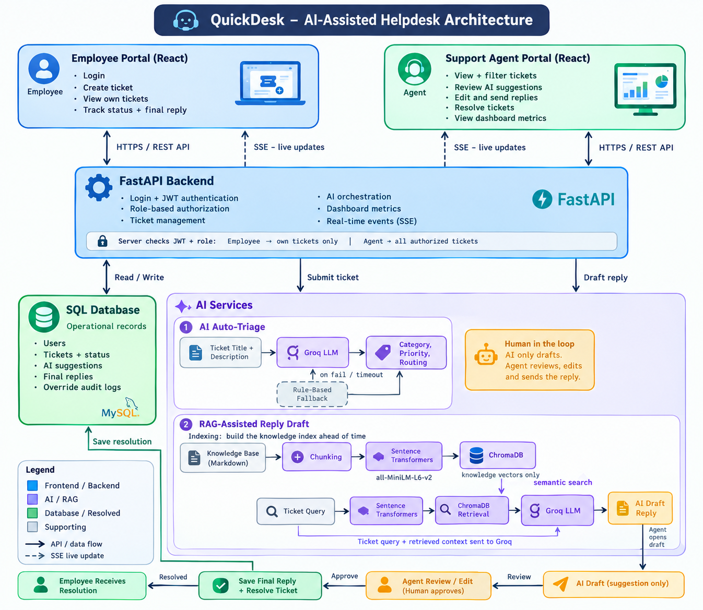

# QuickDesk ⚡

### What this is
QuickDesk is an AI-assisted helpdesk application that helps employees raise support tickets and enables support agents to handle them faster. It uses Groq to suggest ticket categories and priorities, with a rule-based fallback if the AI fails. It also uses a local RAG pipeline to draft replies based on company knowledge articles, with citations for reference. Agents can review and edit AI suggestions, manage tickets, and resolve issues, while SSE provides real-time updates and audit logs track changes.

---

## How to Run Locally

### Prerequisites
* **Python**: 3.11+
* **Node.js**: 18+ and `npm`
* **PostgreSQL**: Running locally on port 5432
* **Groq API Key**: Free key from [console.groq.com](https://console.groq.com)

---

### Step 1: Clone & Configure Environment
```bash
git clone https://github.com/HSG15/quickdesk.git
cd quickdesk

# Copy environment configuration
cp .env.example .env
```
Open `.env` and configure your local PostgreSQL credentials and Groq key:
```env
DATABASE_URL=postgresql://<your_postgres_user>:<your_password>@localhost:5432/quickdesk
GROQ_API_KEY=gsk_...
GROQ_MODEL_NAME=openai/gpt-oss-120b
```

---

### Step 2: Set Up PostgreSQL Database
Ensure your PostgreSQL server is active, then create the database:
```sql
CREATE DATABASE quickdesk;
```

---

### Step 3: Backend Setup & Initialization
```bash
cd backend

# Create and activate virtual environment
python3 -m venv venv
source venv/bin/activate

# Install dependencies
pip install -r requirements.txt

# Seed development users and initial tickets
python scripts/seed_data.py

# Index markdown knowledge base policies into local ChromaDB
python scripts/index_kb.py

# Start FastAPI development server
uvicorn app.main:app --reload --port 8000
```
Backend will be live at `http://localhost:8000`. Swagger API documentation is available at `http://localhost:8000/docs`.

---

### Step 4: Frontend Setup
In a new terminal window:
```bash
cd frontend

# Install dependencies
npm install

# Start Vite dev server
npm run dev
```
Frontend will be live at `http://localhost:5173`.

---

### Step 5: Demo Login Credentials
QuickDesk includes pre-seeded accounts with built-in 1-click role toggling in the UI:

| Role | Email | Password | Permissions |
| :--- | :--- | :--- | :--- |
| **Support Agent** | `agent@quickdesk.com` | `agent123` | View KPIs, live SSE metrics, audited classification overrides, send replies & resolve |
| **Employee** | `employee@quickdesk.com` | `employee123` | Submit tickets, track "My Tickets", view verified resolutions |

---

### Step 6: Running the Automated Test Suite
```bash
cd backend
source venv/bin/activate
pytest -v
```
Runs all 34 automated unit and integration tests covering JWT authentication, fallback classification, Chroma RAG retrieval, route authorization, and atomic audit logging in ~20 seconds.

---

## Architecture Diagram



---

## API Endpoints

All authenticated endpoints require `Authorization: Bearer <token>` header (or `?token=<jwt>` query parameter for SSE).

| Method | Path | Purpose | Auth Required |
| :--- | :--- | :--- | :--- |
| `POST` | `/api/auth/login` | Authenticate user; returns signed JWT and profile | Public |
| `GET` | `/api/auth/me` | Fetch authenticated user profile | Authenticated |
| `POST` | `/api/tickets` | Submit new ticket; runs Auto-Triage & RAG; broadcasts SSE | Authenticated (`employee` / `agent`) |
| `GET` | `/api/tickets/my` | List tickets submitted by the authenticated employee | Authenticated (`employee`) |
| `GET` | `/api/tickets` | List all tickets with filters (`category`, `priority`, `status`) | Agent Only (`require_agent`) |
| `GET` | `/api/tickets/events` | Persistent SSE event stream (`ticket_created`, `ticket_updated`) | Agent Only (`require_agent`) |
| `GET` | `/api/tickets/metrics` | Desk KPIs, SLA stats, AI accuracy agreement rate | Agent Only (`require_agent`) |
| `GET` | `/api/tickets/{id}` | Retrieve ticket details, citations, and draft reply | Authenticated (Owner or Agent) |
| `PATCH`| `/api/tickets/{id}/classification` | Override category/priority with atomic audit log entry | Agent Only (`require_agent`) |
| `POST` | `/api/tickets/{id}/reply` | Submit final resolution reply and lock ticket state | Agent Only (`require_agent`) |
| `POST` | `/api/tickets/{id}/draft-reply` | Re-trigger RAG draft reply generation | Agent Only (`require_agent`) |
| `GET` | `/api/tickets/{id}/audit` | Fetch full change audit trail for a ticket | Agent Only (`require_agent`) |

---

## Decisions and Tradeoffs

### 1. Dual-Path AI Auto-Triage (Groq LLM + Deterministic Fallback)
* **Decision**: We use Groq Cloud AI with `temperature=0.0` to classify tickets and return structured JSON with a strict 5.0-second timeout. If the AI fails, times out, or hits a rate limit, a keyword-based regex system classifies the ticket instead.
* **Tradeoff**: Keyword rules are less intelligent than AI for ambiguous descriptions. However, they keep the application working instead of returning a 500 error or freezing the UI when the AI service is unavailable.

### 2. Local Dense Embeddings on CPU vs. Cloud APIs
* **Decision**: We generate 384-dimensional embeddings locally using `sentence-transformers/all-MiniLM-L6-v2` on CPU (<15ms per query, ~80MB RAM) and store them in persistent local ChromaDB.
* **Tradeoff**: Local embeddings have slightly less semantic capacity than larger cloud models like OpenAI `text-embedding-3-large`. However, we get zero recurring API costs, no external network latency, and complete data privacy because internal company policies never leave the server.

### 3. Server-Sent Events (SSE) vs. WebSockets
* **Decision**: We chose Server-Sent Events (SSE) because our app only needs the server to push real-time ticket updates to clients.
* **Tradeoff**: WebSockets support two-way communication, but our ticket actions (resolving, overriding) are transactional REST requests that require standard HTTP status codes and headers. SSE is simpler, operates over standard HTTP/2, and supports automatic reconnection through the browser's `EventSource` API.

### 4. Immutable Baseline Schema for Continuous Evaluation
* **Decision**: When a ticket is created, we record `category` and `priority` alongside separate immutable columns: `ai_suggested_category`, `ai_suggested_priority`, and `ai_suggestion_method`.
* **Tradeoff**: Adds slight database column overhead. In return, we can continuously track our live **AI Agreement Accuracy Rate** ($(\text{matching} / \text{total}) \times 100$). Without immutable baselines, human agent overrides would overwrite model predictions, permanently erasing our ability to measure LLM performance.

### 5. `404 Not Found` Isolation Masking vs. `403 Forbidden`
* **Decision**: If Employee Bob attempts to view Employee Charlie's ticket via `GET /api/tickets/{charlie_id}`, the server returns `HTTP 404 Not Found` instead of `HTTP 403 Forbidden`.
* **Tradeoff**: Returning 403 reveals that a ticket actually exists at that ID, allowing an attacker to try sequential IDs and estimate company ticket volume. Returning 404 neutralizes horizontal ID scanning completely.

### 6. Frontend Framework Choice (React SPA with Vite vs. Next.js)
* **Decision**: We chose React 19 with Vite instead of Next.js.
* **Why**: Our FastAPI backend already handles the server-side work, so React can focus on the user interface and vite provides a simple and fast development experience and Next.js would have added unnecessary Node.js server runtime complexity

### 7. RAG Pipeline Structure: Chunks, Embeddings, Retriever & Prompt
* **Chunk Size**: We used LangChain's `RecursiveCharacterTextSplitter` with 500 characters chunk size and 50 characters overlap. 
* **Embedding Model**: `sentence-transformers/all-MiniLM-L6-v2` running locally on CPU. It generates 384-dimensional dense vectors in under 15ms per query with zero cloud costs.
* **Retriever & Scoring**: We query top-3 chunks from ChromaDB. Chroma returns squared Euclidean distance ($d$), so we convert it to Cosine Similarity using $\cos(\theta) = 1.0 - (d / 2.0)$. We apply a `+0.05` affinity boost if the article category matches the ticket category, and a `-0.15` penalty for mismatches. If the top score is below `0.35`, the system refuses to answer and escalates to a human agent with 0 citations to prevent hallucinating policy.
* **Prompt**: The system prompt forces the LLM to answer strictly using the provided context chunks and cite them with bracketed IDs (e.g. `[KB-IT-001]`). If the context doesn't contain the answer, it is instructed to explicitly say it cannot help rather than guessing.

### 8. Handling Out-of-Bounds / Invalid LLM Categories
* **Decision**: We have defined a strict Python set of allowed categories, i.e., `{"IT", "HR", "Finance", "Admin", "Other"}`.
* **How it's handled**: In `classifier.py`, after parsing the JSON from Groq, we check if `category in ALLOWED_CATEGORIES`. If the LLM returns an invalid or some other category (like "Hardware" or "Issues related to Payroll"), the validation rejects it and either diverts to our deterministic keyword regex classifier or safely assigns `"Other"`.

### 9. Client-Side JWT Storage (LocalStorage vs. HttpOnly Cookies)
* **Decision**: We stored the JWT in the browser's `localStorage` under `quickdesk_token`.

* **Why?**: It was simple to use with our React frontend and FastAPI backend. Our API client can easily attach the token to API requests. We also use it for SSE connections to receive live updates.

* **Trade-off**: JavaScript can access `localStorage`, so if an attacker finds an XSS vulnerability, they could steal the token. An `HttpOnly` cookie is safer because JavaScript cannot read it.

For this project, we chose `localStorage` to keep authentication simple. For a production application, I would rather consider `HttpOnly` cookies.

### 10. Backend RBAC Enforcement & Stopping URL Guessing
* **Decision**: We never rely on the frontend UI. Every sensitive endpoint has a backend dependency guard: `Depends(require_agent)`.
* **What stops employees from guessing agent URLs**: Even if an employee guesses an agent-only URL or edits their React state in browser DevTools, the backend checks their JWT and verifies their role. If the role is not an agent, they are immediately returned `HTTP 403 Forbidden`. The request is blocked before touching any database logic.

### 11. Real-Time Streaming & Mid-Session Disconnect Handling
* **Choice**: We chose Server-Sent Events (SSE) because our app only needs the server to send updates to the browser. It uses normal HTTP and works well with corporate proxies, so we don't need the extra complexity of WebSockets.
* **Failure Mode on Disconnect**: If an agent's Wi-Fi drops or their laptop sleeps mid-session:
  1. The browser's native `EventSource` automatically tries to reconnect every 3–5 seconds without needing extra custom code.
  2. FastAPI detects the disconnected client and cleans up its queue to avoid wasting memory.
  3. Limitation: Any events missed during the disconnection may be lost because they are stored in memory. When the client reconnects, the frontend fetches the latest ticket list to get back in sync.

### 12. Worst Failure Mode in the System Today & How to Fix It
* **The Worst Failure Mode**: Our real-time notification system stores connected agents in the backend's memory. If the backend restarts, all connections are lost. Also, if we run multiple backend containers, an agent connected to one container may miss events sent by another container.
* **How to Fix It**: Use Redis Pub/Sub as a shared messaging system. Whenever a ticket is created or updated, the backend publishes an event to Redis. All backend containers receive that event and send it to their connected agents.

### 13. Where AI Tools Helped Most vs. Where They Misled Me
* **Where AI Helped Most**:
  - Generate basic backend code, database models, and data validation.
  - Build the frontend layout and notification sound.
  - Write automated tests to check whether the application works correctly.
  - Debugging and troubleshooting complex issues.
  
* **Where AI Misled / Hurt**:
  - **Wrong similarity calculation in RAG**: AI suggested an incorrect formula for comparing documents. This caused some relevant documents to be ignored. I researched the distance calculation and corrected the formula.
  - **Unavailable AI model**: AI suggested a Groq model that returned a 404 Not Found error. I checked which models were available and switched to `openai/gpt-oss-120b`.   
  - **Incorrect API route order**: AI placed a dynamic route before fixed routes in FastAPI. As a result, requests such as /metrics were treated as ticket IDs and threw 422 errors. Moving the fixed routes above the dynamic route solved the issue.

---

## What I Would Do With More Time

### 1. Load Balancing & Scaling (100 to 10,000+ Employees)
Deploy multiple FastAPI containers behind an NGINX or AWS Application Load Balancer (ALB) to distribute incoming traffic. Decouple LLM triage and RAG generation from the main request path using background worker queues (like Celery or ARQ with Redis), keeping ticket submission instant (<50ms).

### 2. Redis Pub/Sub for Distributed SSE
Currently, SSE events are stored in-memory using `asyncio.Queue`, which works for a single server instance. Moving to Redis Pub/Sub would share events across multiple backend containers so all active agents receive live updates regardless of which server they are connected to.

### 3. Multi-Provider LLM Failover Architecture
Build a cascading LLM router:
* **Tier 1**: Fast, high-throughput inference (Groq / Cerebras).
* **Tier 2**: Secondary cloud provider fallback (Anthropic Claude 3.5 Sonnet / OpenAI GPT-4o-mini) if Tier 1 times out or hits rate limits.
* **Tier 3**: Local deterministic keyword heuristics if all cloud networks are unreachable.

### 4. Smart FAQ & Ticket Deflection (Similar Questions)
Track frequently asked questions and resolved tickets. When an employee starts typing their ticket title or description, perform instant semantic search to suggest relevant answers right away. If an existing solution resolves their issue, they won't even need to submit a ticket.

### 5. AI Feedback & Rating Loop
Add a thumbs up/down and rating mechanism for AI-drafted replies. Support agents and employees can rate how helpful the suggestion was, generating data to evaluate prompt quality and fine-tune future model drafts.

### 6. Ticket Archiving & Retention (Trash Bin / Year-Wise)
Add a soft-delete trash bin and an automated retention policy that archives resolved tickets older than 1–2 years into year-wise cold storage. This keeps the active database lean and queries fast while preserving compliance records.

### 7. SLA Deadlines & Escalation Alerts
Set target resolution times based on ticket priority (e.g., High-priority tickets must be resolved within 4 hours). Include a live countdown timer and send automated push notifications to agents when a ticket is approaching or breaching its SLA deadline.

---

## Known Issues / Limitations
1. **In-Memory SSE Broker**: The current `EventBroadcaster` uses an in-memory `asyncio.Queue` registry. Real-time updates only broadcast to clients connected to that specific backend process. Multi-instance production requires a Redis backplane.
2. **Synchronous Ingestion Latency**: Embedding and drafting a RAG reply occurs inline during `POST /api/tickets`, adding ~1.0–1.8 seconds to initial ticket creation. Moving this to background processing with optimistic frontend UI updates would yield sub-100ms response times.
3. **Static Knowledge Base Indexing**: Updating internal policy Markdown files currently requires re-running `scripts/index_kb.py`. An administrative upload endpoint with automatic vector upserting and chunk invalidation would make knowledge management dynamic.
4. **Local PostgreSQL Dependency**: The backend is configured for PostgreSQL and does not support SQLite fallback out of the box due to PostgreSQL-specific array/JSON operations.
